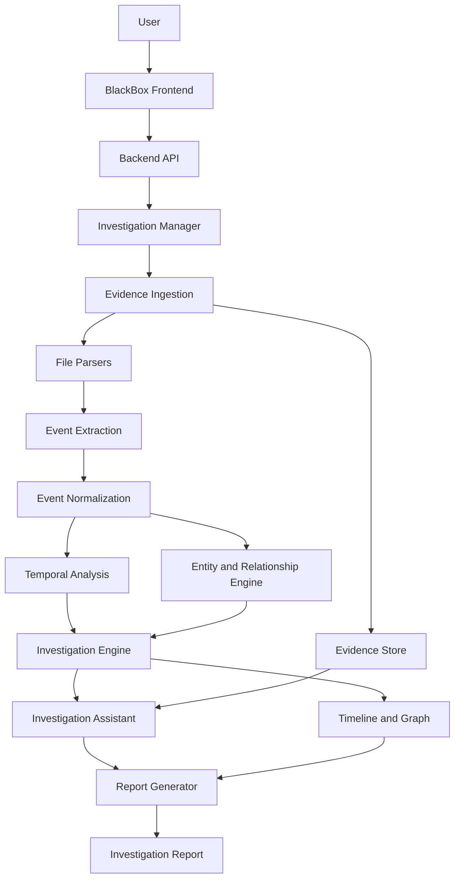

# Architecture

BlackBox uses a **modular monolith** — a single deployable backend composed of
logically independent modules — plus a React frontend. This keeps development
and deployment simple while letting each engine evolve and be tested on its own.
We deliberately avoid microservices, Redis, Kafka and graph databases until a
concrete requirement justifies them.

## Modules

| Module | Responsibility |
|---|---|
| **Frontend** | Investigation creation, evidence upload, timeline, relationship graph, conflict visualization, report viewing. |
| **Backend API** | Investigation management, evidence metadata, processing orchestration, report endpoints. |
| **Ingestion** | File validation, format detection, parser selection, evidence registration. |
| **Event engine** | Event extraction, normalization to the common event model, validation. |
| **Temporal engine** | Timestamp normalization, timezone handling, conflict/drift/duplicate detection, ordering constraints, uncertainty representation. *(The core differentiator.)* |
| **Relationship engine** | Entity extraction/resolution, relationship identification, event correlation. |
| **Evidence management** | Original evidence storage, references, SHA-256 hashing, integrity verification, provenance. |
| **Investigation assistant** | *(Optional, off by default.)* Grounded natural-language Q&A and hypothesis generation over structured evidence. |
| **Reporting** | Report generation and export (PDF, JSON, Markdown). |

## Data flow

## Design principles

- **Deterministic core.** Normalization, timeline construction, timestamp validation, integrity checks and configured anomaly detection are deterministic. AI assists interpretation only — it is never a source of truth and the system runs fully without it.
- **Preserve originals.** The temporal engine never silently rewrites timestamps to produce a clean timeline; it preserves originals, shows normalized values, and makes conflicts/uncertainty explicit.
- **Evidence-first.** Facts, extracted records, inferred relationships, AI hypotheses and user-confirmed conclusions are kept distinct and every finding is traceable to source.
- **Extensible.** New parsers, event types and domain rules are added via workspace configuration without changing the core engine.
